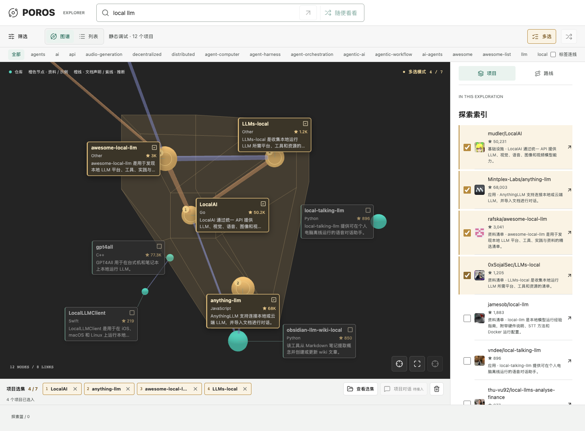

<div align="center">

# POROS

### Find the connections. Explore what comes next.

把 GitHub 搜索结果变成可探索、可追溯的项目关系图谱。

**Explorer Alpha** · Local-first · Bring your own API key · [MIT](LICENSE)

[快速体验](#快速体验) · [真实检索](#真实检索) · [配置说明](docs/configuration.md) · [更新记录](CHANGELOG.md)

</div>



## 不止是一个项目列表

一个关键词，发现一批项目；阅读它们的材料，理解彼此的关联；选中感兴趣的几个，为下一次探索留下上下文。

| 现在可以做什么 | 如何使用 |
| --- | --- |
| 发现 GitHub 项目 | 输入关键词或「随便看看」，按 Star、语言、最近提交筛选 |
| 在 3D 图谱中浏览 | 聚焦节点，联动列表和详情；WebGL 不可用时可切换列表 |
| 看关系背后的材料 | 手动整理关系与路线，查看事实摘录、来源链接和覆盖缺口 |
| 保留一组选中的项目 | 最多选 7 个，弹性聚拢、局部聚焦、材料预览与 JSON 导出 |
| 接着探索 | 从节点展开相关项目，查看保存的图谱版本；选集保存在当前浏览器 |

**这是早期可运行版本，不是全网知识图谱。** 当前按小批量项目整理；模型判断可能有误，需要结合引用核对。空间包围体只是选集可视化，不代表已经验证的技术交集。多项目持续对话、自动方案生成尚未接入。

## 快速体验

准备 [Node.js](https://nodejs.org/en/download) 22.12+ 与 [pnpm](https://pnpm.io/installation)。当前验证使用 pnpm 11.9.0。需要现代浏览器；3D 视图需要 WebGL。

下载并启动：

```bash
git clone https://github.com/WaldenDev/POROS.git
cd POROS/apps/web
pnpm install --frozen-lockfile
pnpm dev
```

打开 **[http://127.0.0.1:5177/](http://127.0.0.1:5177/)**。

默认加载历史示例：12 个项目、61 条事实、8 条关系、6 条路线。无需 Python、后端或 API key，也不会触发搜索和模型请求。第三方头像可能需要网络。搜索和分析暂时锁定，详情、多选、聚焦和导出可以操作。

试用顺序：**点击项目 → 查看来源 → 多选几个项目 → 聚焦选集 → 查看选集 / 导出**。

也可以构建独立演示站：

```bash
pnpm build:demo
pnpm preview:demo
```

打开 [http://127.0.0.1:5178/](http://127.0.0.1:5178/)。`dist-demo/` 可作为静态站部署；即使 URL 加上 `?mode=live`，演示构建也不会启用业务 API。

## 真实检索

额外准备 [uv](https://docs.astral.sh/uv/getting-started/installation/) 和 Python 3.12+（uv 可安装 Python）。SQLite 随 Python 提供，不需要单独运行数据库服务。

**终端一：在项目根目录配置并启动 API。**

```bash
cd apps/api
uv sync --frozen
uv run python -m poros_api.setup
uv run python -m poros_api.setup --check
uv run uvicorn poros_api.public_main:app --host 127.0.0.1 --port 8787
```

向导会询问 GitHub token、模型接口、模型 ID 和 key；密钥输入不回显，写入 `apps/api/.env`，不会覆盖已有配置。`--check` 只检查本地字段，不消耗额度，也不代表连接测试通过。

支持 **Gemini** 或 **OpenAI-compatible Chat Completions**。后者填写供应商给出的 Base URL、key 和模型 ID，不要求安装本地模型。详细示例见 [配置说明](docs/configuration.md)。

**终端二：在项目根目录启动前端。**

```bash
cd apps/web
pnpm install --frozen-lockfile
pnpm dev
```

打开 **[http://127.0.0.1:5177/?mode=live](http://127.0.0.1:5177/?mode=live)**。只有 GitHub、没有模型时可先浏览检索结果；模型配置完整后，再到「路线」手动点击「整理关系与路线」。关联展开和图谱分析可能消耗模型额度，未设置账户级费用硬上限。

## 配置与边界

- 密钥只放在 `apps/api/.env` 或服务端环境变量，**不要写入 `VITE_*`**。配置改变后重启 API。
- GitHub token 可留空使用匿名查询，但限流更低；只访问公开项目，不需要仓库写权限。
- API 默认只监听本机。当前没有多用户鉴权，不要直接暴露到公网或分享自己的模型密钥。
- 模型服务会接收查询和选中项目的公开材料；示例快照不是实时排行，项目内容及许可归原作者。
- 后端图谱存入本地 SQLite；浏览器选集是本地保存，不是账号云同步。

## 开发与构建

React / TypeScript / Three.js · FastAPI / Python · SQLite

```text
apps/web/src/explorer/   图谱界面、交互与演示数据
apps/api/poros_api/      检索、材料提取、关系整理、模型适配与存储
docs/configuration.md   配置与故障排查
CHANGELOG.md            面向使用者的简短更新记录
```

前端正式 Explorer 构建：在 `apps/web` 运行 `pnpm build:explorer`。生成 `dist/`，不包含旧工作台或演示快照；仍需另行启动后端。独立演示请使用 `build:demo`。

后端配置回归：在 `apps/api` 运行 `uv run python -m unittest test_release_setup`。前端数据回归：在 `apps/web` 运行 `pnpm exec tsx --test tests/static-preview.test.ts`。

首发围绕 Explorer 收敛，历史工作台与旧 idea 工作流不作为首版产品。POROS 自有代码采用 [MIT](LICENSE)；依赖、项目名称、头像与引用材料保留各自的许可和权利，见 [第三方内容](THIRD_PARTY.md)。欢迎通过 [Issues](https://github.com/WaldenDev/POROS/issues) 反馈体验问题；参与开发见 [贡献说明](CONTRIBUTING.md)。
